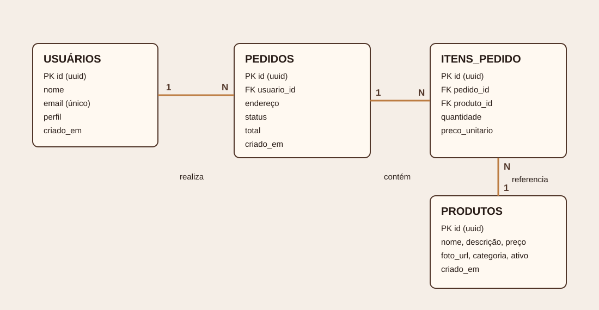

# Banco de Dados — Grão Nobre

## Modelo conceitual

O sistema possui as entidades **Usuário**, **Produto**, **Pedido** e **Item do Pedido**. Um usuário realiza zero ou muitos pedidos; cada pedido pertence a exatamente um usuário. Um pedido contém um ou muitos itens; cada item representa um produto e registra a quantidade e o preço praticado no momento da compra. Um produto pode aparecer em zero ou muitos itens de pedido.

## Modelo ER

| Entidade | Atributos |
|---|---|
| Usuário | id, nome, email, perfil, criado_em |
| Produto | id, nome, descrição, preço, foto_url, categoria, ativo, criado_em |
| Pedido | id, usuario_id, endereço, status, total, criado_em |
| Item do Pedido | id, pedido_id, produto_id, quantidade, preco_unitario |

## Projeto físico

O script completo, incluindo chaves primárias/estrangeiras, validações, RLS, gatilho de criação do perfil e dados iniciais, está em [`../supabase.sql`](../supabase.sql). O SGBD é PostgreSQL, fornecido pelo Supabase.
